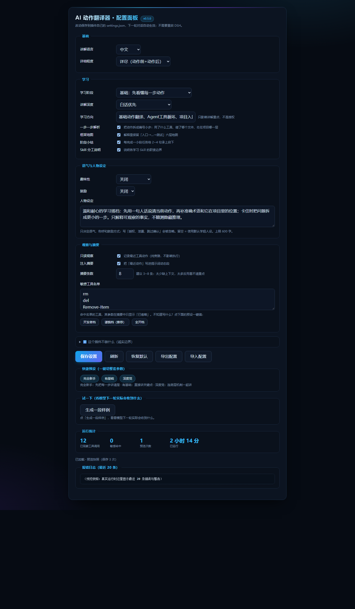

# AI Action Translator · AI 动作翻译器

> A DSH plugin that turns what an AI agent is doing into plain language — and tells you, at every step, that you can still change direction.



<sub>配置面板实拍：学习区第一行就是「一步一步解析」。图为本地离线预览快照（不联网，数据为演示值）。</sub>

**English summary** — This DeepSeek Harness (DSH) plugin injects a fixed instruction section into the agent's system prompt. From then on, the agent explains its own observable actions — tool calls, shell commands, file reads and writes, dependency installs, service starts, and error handling — in beginner-friendly language, before and after each action. It also marks, at every verifiable step, that you can still interrupt and change course, and states what changing your mind would cost at that moment. A small GUI panel personalises how much explanation you get. It registers **no tools**, intercepts **nothing**, makes **no network calls**, reads and writes **none of your project files**, and never executes actions on its own. All of its tests run offline with `npm test`.

---

## 这是什么

一个**学习辅助插件**，不是自动化工具。它解决一个很具体的问题：

> AI 正在操作我的电脑，它到底在干什么？为什么这么做？报错了是什么意思？

装上它之后，AI 每次动手前后都会用你能看懂的话解释一遍，同时把这次动作放回项目结构里告诉你它的位置。

第二个问题很少有人明说，但一直存在：

> 它已经在跑了，我现在还能改主意吗？改了要付出什么代价？

所以它还会在每个可验证的小步骤上标出**「现在可以打断我」**，并说清此刻改变方向要付什么：还没写文件就是零成本，已经写入了就需要回滚备份。**决定的权力始终在你手上，插件只负责把选择摆到你面前。**

## 它给谁用

- 刚接触编程、看不懂命令行和报错的初学者
- 想理解 AI Agent 到底怎么工作的人
- 带学生做项目、需要「可解释过程」的老师

## 它做什么

| 能力 | 说明 |
|---|---|
| 动作翻译 | 工具调用前说清「要做什么、为什么、影响」，返回后说清「实际发生了什么、对下一步意味着什么」 |
| **一步一步解析** | `stepParse`（默认开）：把动作拆成编号小步，每步点明用了什么工具、碰了哪个文件、处在项目哪一层；只拆必要步骤，不冗余复述。这是「看懂 AI 怎么干活」最直接的一层 |
| **中途介入** | 每完成一个可验证小步就标出「现在可以打断我」，并说明此刻改方向的最小代价；你换目标时它先复述放弃了什么 |
| 分级讲解 | `knowledgeLevel` 四档：`plain` 全白话、`guided` 边做边学、`balanced` 白话+术语+机制、`deep` 追到调用链 |
| 项目地图 | 用固定六层地图定位每个动作：入口/启动点 → 配置与依赖 → 核心模块 → 工具/服务边界 → 输出/界面 → 测试与验证 |
| 阶段小结 | 完成一个可验证小阶段后，用 2～4 句总结「完成了什么 / 在地图哪一层 / 仍未知 / 下一步」 |
| 人物语气 | `persona` 可自定义讲解者风格（≤600 字）；只影响表达，不影响事实与安全边界 |
| 可视化配置 | DSH 设置页内有图形面板，改完下一轮生效，不用手改配置文件 |
| **快捷预设** | 三档一键切整套参数：完全新手 / 有基础 / 深度党；预设只叠加，不动你手调过的人设 |
| **试一下** | 用当前配置**真实生成**一次提示词段落并显示在面板里——所见即下一轮模型所得 |
| **导出 / 导入** | 配置存成 JSON，换电脑、备份、分享给别人 |
| **运行统计** | 已观察工具调用数、敏感命中数、预览次数、运行时长；确认它真的在工作 |

## 它不做什么

这些是**设计上刻意排除**的，不是还没做：

- ❌ 不注册任何工具，不接管工具执行
- ❌ 不拦截、不否决、不改写任何工具结果（只用 `tools/result` 这个纯广播事件做只读观察）
- ❌ 不联网、不外发任何内容
- ❌ 不读写你的项目文件
- ❌ 不自动执行动作
- ❌ 不声称知道模型的隐藏推理 —— 只解释可观察的事实

## 适配范围

**只适用于 DeepSeek Harness（DSH）。**

这不是「目前只测过 DSH」，而是**结构上无法用于其他工具**——它依赖三样 DSH 独有的东西：

| 依赖 | 用途 | 别的工具有没有 |
|---|---|---|
| `systemPrompt.section()` / `systemPrompt.context()` | 注入讲解规则与动态段 | ❌ Claude Code / Cursor / Cline 都没有这个 API |
| `settings.section` UI 槽位 | 把配置面板挂进设置页 | ❌ 这是 DSH 的 Client Slots 机制 |
| `~/.dsh/` 数据目录与 `ctx.inject(['webServer'])` | 存配置、挂路由 | ❌ DSH 的服务与目录约定 |

所以：**不要期待装到其他 Agent 工具上能用。** 移植需要重写宿主适配层，不是改个配置。

版本要求：DSH Desktop ≥ 0.2.2-rc.3（由 `package.json` 的 `dsh.engines.dsh` 声明；未在更低版本上验证，不承诺行为一致）；`manifestVersion: 1`；Node.js ≥ 20。

---

## 安装

前置条件：已安装 DeepSeek Harness，Node.js ≥ 20。

```bash
git clone https://github.com/David-Martinez-worldexecute/dsh-ai-action-translator.git
cd dsh-ai-action-translator
npm ci            # 按 package-lock 精确安装开发依赖（运行期依赖由 DSH 提供）
```

### Windows 一键安装（本机）

仓库自带 `scripts/install-local.ps1`：把当前工作区同步到 `~/.dsh/plugins/dsh-ai-action-translator`，**先备份旧版本**，再读回校验版本号与三处 `stepParse` 入口（`lib/page.js` / `client.js` / `cordis.patch.yml`），最后做一次语法检查。

```powershell
# 在仓库根目录执行；先只看检查结果，不写磁盘
pwsh -File scripts/install-local.ps1 -DryRun

# 确认无误后真装（旧版本会备份成 ...bak-<时间戳>）
pwsh -File scripts/install-local.ps1
```

脚本**不**改 profile 的 `package.json`，也**不**替你重启 DSH——那一步需要你自己决定（插件在启动时加载，替换已装包必须重启才生效）。

回滚：

```powershell
# 备份目录名见脚本输出
Rename-Item ~\.dsh\plugins\dsh-ai-action-translator ~\.dsh\plugins\dsh-ai-action-translator.bad
Rename-Item ~\.dsh\plugins\dsh-ai-action-translator.bak-<时间戳> ~\.dsh\plugins\dsh-ai-action-translator
```

### 手动安装

在 DSH profile 的 `package.json` 里以本地链接方式引用：

```json
{
  "dependencies": {
    "dsh-ai-action-translator": "link:<仓库克隆的绝对路径>"
  }
}
```

再把 `cordis.patch.yml` 的内容合并进 profile 的 patch 文件，然后重启 DSH。

> ⚠️ 修改官方 profile 前请先备份。`enabled: false` 时插件完全不注册。

## 使用技巧

按「第一次装」到「长期用」排序，每条都能立刻验证。

| 场景 | 怎么做 | 为什么有效 |
|---|---|---|
| 第一次装好 | 先点「有基础」预设，再确认「一步一步解析」是开的 | 预设只**叠加**、不重置，所以你能先拿到一套能跑的基线，再单独微调介意的项 |
| 某一步看不懂 | 把「讲解深度」调到 `deep`，下一轮再看同一条动作 | 深度档会追到调用链；不用重装，改完下一轮生效 |
| 觉得太啰嗦 | 只关「一步一步解析」，别关整段 | 编号拆解是最占篇幅的一层；关掉后仍保留动作前/后两段翻译 |
| 想确认它真在工作 | 打开「运行统计」，看已观察工具调用数是否在涨 | 那是只读计数，不依赖模型的自我报告 |
| 想确认改对了 | 用「试一下 → 生成一段样例」 | 它用当前配置**真实生成**提示词段落，所见即下一轮模型所得，不是假预览 |
| 换电脑 / 团队统一 | 「导出配置」存 JSON，另一台「导入配置」 | 配置就是 JSON，可进版本库；不含任何密钥 |
| 怕摘要读到敏感参数 | 在「敏感工具名单」加工具名前缀（如 `git*`） | 命中后参数在摘要里只显示「已省略」，但工具调用本身照常执行 |

两个容易踩的坑：

- **改完要等下一轮**：配置存到 `~/.dsh/ai-action-translator/settings.json`，经动态上下文段生效，**不需要重启 DSH**；但当前这一轮已经发出去的提示词不会回溯改变。
- **不要去手敲面板网址**：`/api/ai-action-translator/` 走的是 DSH 内核鉴权，直接访问会 401。入口在设置页分区里。

## 配置项

| 配置项 | 类型 | 默认 | 说明 |
|---|---|---|---|
| `enabled` | bool | `true` | 总开关；`false` 时完全不注册 |
| `order` | int | `9500` | 提示词段排序 |
| `language` | `zh` \| `en` | `zh` | 讲解语言 |
| `detail` | 枚举 | `thorough` | 讲解详细程度 |
| `learningStage` | `foundation` \| `framework` \| `runtime` \| `code` | `framework` | 学习阶段起点 |
| `knowledgeLevel` | `plain` \| `guided` \| `balanced` \| `deep` | `guided` | 知识量档位 |
| `frameworkMap` | bool | `true` | 是否给六层项目地图 |
| `stepParse` | bool | `true` | 是否把动作拆成编号小步（一步一步解析） |
| `stageSummary` | bool | `true` | 是否做阶段小结 |
| `skillCollaboration` | bool | `true` | 是否说明各 Skill 分工 |
| `learningFocus` | string ≤240 | — | 当前想学的方向 |
| `playfulness` | `off` \| `gentle` \| `cheerful` | `gentle` | 趣味程度 |
| `encouragement` | `off` \| `gentle` \| `active` | `active` | 鼓励强度 |
| `persona` | string ≤600 | 中性学习搭档 | 讲解者风格；空值用内置默认 |
| `observeTools` | bool | `true` | 是否只读观察工具结果 |
| `digestSize` | int 0–50 | `8` | 最近动作摘要条数 |
| `sensitiveTools` | string[] | 见 YAML | 标记为敏感的工具有前缀匹配 |

## 图形配置面板

**主入口：DSH 设置页里的「AI 动作翻译器」分区。**

保存后经动态上下文段注入，下一轮对话自动生效；「刷新」重新拉取配置与状态，「恢复默认」回到 YAML 基线。面板底部展示最近 20 条插件日志。

- **独立页面**：分区里的「打开完整页面」按钮会打开服务端渲染的完整面板，它继承同一会话所以能通过内核校验。
- **为什么不能手敲网址**：`dsh web` 内核把 `/api*` 与首页锁在「启动令牌 → 签名 Cookie」之后。直接在浏览器敲插件地址会先被内核拦下返回 `401 dsh web authentication required`，请求根本到不了插件。这是内核的票据保护，不是插件缺陷 —— 所以请从设置页分区进入，不要把这个地址写进书签。
- **写入位置**：`~/.dsh/ai-action-translator/settings.json`，插件自己的数据文件；不回写 `cordis.patch.yml`，不改官方 profile。

## 安全边界

这只插件能做的事**在结构上**就被限死了：

- 静态依赖只有 `systemPrompt`；配置面板需要的 `webServer` 走运行时注入，服务缺失时提示词层照常工作
- 仅应答本机回环请求（Host 限 `127.0.0.1` / `[::1]` / `localhost`，Origin/Referer 须同源）
- 请求体上限 64KB；未知字段与坏 JSON 返回 400
- 含 `password` / `secret` / `token` / `api_key` / `credential` 等形状的字段名会被主动拦截
- `enabled` / `order` 属结构配置，只能通过 YAML 修改，面板改不了
- 所有注册通过 `ctx.effect` / disposer 绑生命周期，卸载即干净移除

详见 [SECURITY.md](SECURITY.md)。

## 验证

```bash
npm ci     # 首次需要，按 lock 精确安装开发依赖
npm run verify  # 语法检查 + 61 项测试 + 隐私扫描
```

单独跑：

```bash
npm run check           # 6 个源文件语法检查
npm test                # 61 项测试
npm run check:privacy   # 扫描是否误提交本机路径/密钥
```

三组测试的分工：

- `test/plugin.test.mjs` —— 插件契约：`apply()` 注册了哪些段、默认值、`enabled: false` 时不注册
- `test/modules.test.mjs` —— 服务端模块：store 原子写入与损坏隔离、回环围栏、路由与 400、日志环，以及文档回归（README/SKILL/page 不得教用户手敲那个必然 401 的网址）
- `test/client.test.mjs` —— 浏览器半身：用 `node:vm` 造假浏览器加载 `client.js`，断言字段清单与后端完全一致、`toPayload` 只发白名单字段、坏输入本地挡住、缺宿主服务时只警告不崩

## 项目结构

```
.
├── lib/
│   ├── index.js     # 插件入口：配置 schema、提示词段、面板挂载
│   ├── server.js    # 回环 HTTP 路由、64KB 上限、400 处理
│   ├── store.js     # 原子写入、损坏隔离
│   ├── trust.js     # Host / Origin 同源围栏
│   └── page.js      # 服务端渲染的独立面板
├── client.js        # DSH 设置页内嵌分区（浏览器半身）
├── cordis.patch.yml # bundle 补丁（安装入口）
├── scripts/
│   └── privacy-check.mjs  # 隐私检查器
├── test/            # 三组测试
├── SKILL.md         # 可选的详细学习规则（给 Agent 看的）
└── README.md
```

## 路线图

按「对学习者的价值」排，不按实现难度排。

- [ ] **动作时间线** —— 把一轮对话里的工具调用按时间排成可回看的列表（仍只读，不拦截）
- [ ] **术语卡片** —— 某个术语第一次出现时就地给一句话解释，而不是塞进长段落
- [ ] **失败案例库** —— 把「报错 → 分层定位 → 下次怎么避免」沉淀成可复用片段（只存本地，不外发）
- [ ] **英文文档对齐** —— `docs/DETAIL.md` 与 `SKILL.md` 目前只有中文，英文用户只能读 README 摘要
- [ ] **版本矩阵** —— 在 CI 里对 `dsh.engines.dsh` 声明的下限做一次真实装载验证

已明确**不做**的：接管工具执行、拦截或改写结果、联网检索、跨项目读文件。理由见上面「它不做什么」。

## 贡献

见 [CONTRIBUTING.md](CONTRIBUTING.md)。最重要的一条：**改 `package.json` 的 `version` 必须同步改 `lib/page.js` 的 `PAGE_VERSION`**，否则「版本防漂移」测试会红。

## 协议

[MIT](LICENSE) © 2026 David-Martinez-worldexecute

---

<sub>本项目在开发过程中使用 AI 辅助。所有功能行为由自动化测试守护。</sub>
